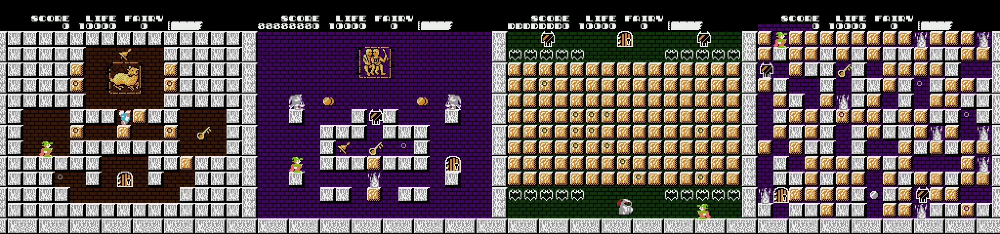

# Solomon's Key — Secret Hints (NES)

A small ROM hack for **Solomon's Key (USA)** that puts a small, subtle **ring** on every tile hiding a secret, so you can find hidden items without a guide.



> **Help wanted: playtesting.** This needs more people playing it. If you find a bug, crash or anything that looks wrong, please [open an issue on GitHub](https://github.com/andrewjose/solomons-key-secret-hints/issues) and include the round number, your emulator or flash cart, and a screenshot if a ring is missing or on the wrong tile.

## Turning it on

The hints are **off by default**. On the title screen, enter the Konami code:

**↑ ↑ ↓ ↓ ← → ← → B A**

You'll hear a confirmation sound. Then press Start to play with the hints on. They stay on until you reset or power off.

## What gets marked

- **Items inside brown blocks**: bonus items, jars, hidden zodiac signs, keys hidden in blocks.
- **Empty cells where you must create and then destroy a block**: hidden bells, fairies, keys and **Solomon's Seals**.
- **Bomb Jack's block** (hit 11 times) in rounds 17 and 40.

The markers come from the game's own room data as each room is drawn, not from a hard-coded list. So they always match what the game will actually reveal:

- Seals only show when the seal will really appear (that is, you haven't broken the seal chain).
- Chained hidden bonus items stop being marked once you've missed one, because the game stops placing them.
- Bomb Jack is only marked when the game's own condition for him is met.

Breaking a marked block or making a block on a marked cell redraws the tile normally, and the ring goes away.

## How to install and play

1. Get your own **headered** `Solomon's Key (USA).nes` (iNES, 65,552 bytes). This repo doesn't provide one.
2. Download [`patch/Solomons_Key_Secret_Hints.ips`](patch/Solomons_Key_Secret_Hints.ips).
3. Apply it with [Rom Patcher JS](https://www.marcrobledo.com/RomPatcher.js/) (in your browser), [Flips](https://github.com/Alcaro/Flips) or Lunar IPS. Patch a copy, not your only ROM.
4. Optionally check the result against the CRC32 below.
5. Play in any NES emulator (Mesen, FCEUX, Nestopia, RetroArch) or on a flash cart. On the title screen, enter the Konami code (see [Turning it on](#turning-it-on)) and press Start.

| | CRC32 (without header) |
|---|---|
| Patched PRG+CHR | `944491BA` |

## Building from source

Needs Python 3 and your own headered `Solomon's Key (USA).nes` (no ROM data is included here).

```
git clone https://github.com/andrewjose/solomons-key-secret-hints
cd solomons-key-secret-hints
pip install -r requirements.txt        # py65 builds; cynes, numpy, Pillow are only for the test tools

# 1. assemble the hack into a patched ROM
python tools/build.py sk_hints.nes "path/to/Solomon's Key (USA).nes"

# 2. check it: should print 944491BA (CRC32 of PRG+CHR, the 16-byte header skipped)
python -c "import zlib,sys; print('%08X' % zlib.crc32(open(sys.argv[1],'rb').read()[16:]))" sk_hints.nes

# 3. make an IPS from the original and the patched ROM
python tools/ips.py "path/to/Solomon's Key (USA).nes" sk_hints.nes Solomons_Key_Secret_Hints.ips
```

The ring colors can be changed with the `BGC` and `BLKC` environment variables (palette index 0–3) when running `build.py`; the CRC above is for the defaults.

## How it works

- The room bulk-draw routine at `$9661` calls `$9E21` to build each 16×16 cell's tile buffer. The patch redirects that call (`$96A6`) to a small routine placed in unused PRG space at `$B500`.
- The routine reads the cell from the room map (`$0304 + pos`):
  - `$40–$7F`: hidden item revealed by make-and-break.
  - `$80–$F7` with low 6 bits ≠ `$10`: brown block containing an item.
  - Bomb Jack cells: level `$10` pos `$7E`, level `$27` pos `$56`, gated on `$7C & $10` like the game's own scripts.
- For a marked cell, it swaps the cell's top-left tile for a ring-marked copy of that tile. The ring sits near the cell's center and leaves the rest of the tile intact.
- The ring tiles are drawn into three BG tiles that are unused during gameplay, in CHR banks 0–2:
  - `$98`: background bricks with a gray ring.
  - `$25`: brown block with a dark ring.
  - `$27`: white block with a dark ring (used for Bomb Jack in round 17).

### Konami code toggle

- The NMI's controller-read call (`$80D2`) is redirected to a detector that runs only while the title screen's CHR bank (bank 3) is active.
- The NMI's CHR bank switch (`$8051`) is hooked to record the current bank in `$07E3`.
- The detector watches newly pressed buttons on `$82`, tracks progress in `$07E1`, sets the enable flag `$07E0` and plays sound `$18`.
- The marker routine does nothing unless `$07E0` is set. These RAM bytes are unused by the game and are cleared on reset.

## Tools

`tools/` holds the Python scripts used for research and building (`pip install -r requirements.txt`):

- `build.py`: assembles the hook and writes a patched ROM (needs `py65`). Usage: `python tools/build.py out.nes "Solomon's Key (USA).nes"` (the ROM argument defaults to that file name in the current folder).
- `ring.py`: generates the ring-marked CHR tiles. Ring colors can be changed with the `BGC` and `BLKC` environment variables (palette index 0–3).
- `ips.py`: makes an IPS from the original and patched ROMs: `python tools/ips.py original.nes patched.nes out.ips`.
- `parse.py`: dumps per-level item data.
- `d65.py`: quick 6502 disassembler (takes the ROM path as its argument).
- `emu.py`, `boot.py`, `survey.py`, `shots.py`: headless testing with `cynes` (plus `numpy` and `Pillow`). `survey.py` takes the ROM path; `shots.py` takes `patched.nes out.png 1,2,3` (round numbers). Scratch files go to the system temp folder.

No ROM data is included in this repository.

## Credits

Item and level data layout comes from Kai E. Frøland's *Solomon's Key ROM map* (romhacking.net).
